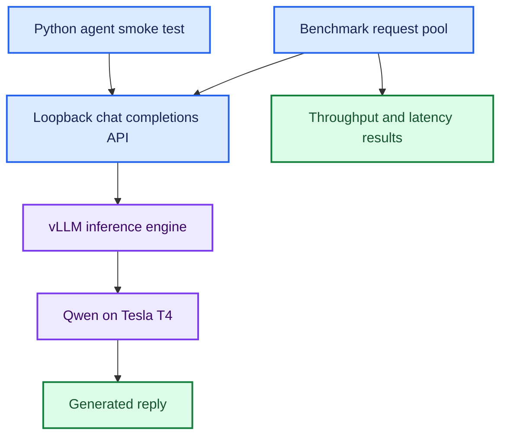
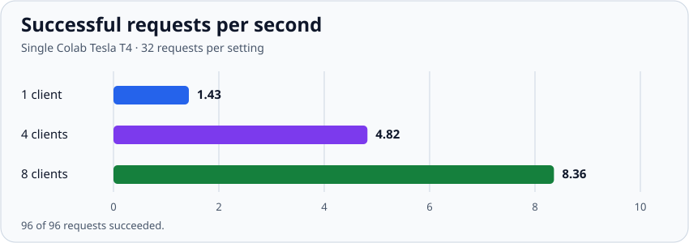
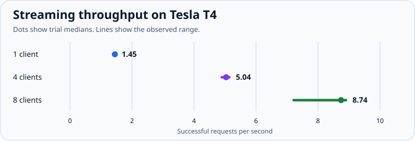
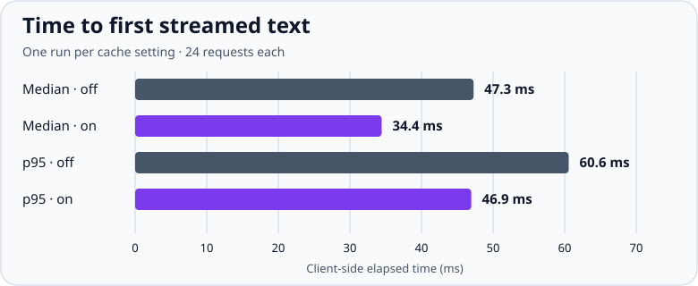

# 🚀 vLLM Agent Inference

**🟦 Learn AI · 🟩 Portfolio evidence · 🟪 PhD research**

Serve Qwen with vLLM, connect a Python agent through a loopback API, and measure how concurrent requests affect throughput and latency on one Google Colab Tesla T4.

## 🧭 Explore the project

[🟦 Base tutorial](#base-tutorial) · [🧩 Contributions](#contributions) · [🧭 Roadmap](#roadmap) · [🏗️ Architecture](#architecture) · [🚀 Setup](#setup) · [🧪 Results and verification](#results) · [🗂️ Evidence and guides](#evidence) · [🟪 Thesis connection](#research) · [🎨 Visual standard](https://github.com/anne500/multi-agent-study-guide/blob/main/VISUAL_STYLE.md)

## 🟦 Base tutorial

Darsh Shah’s [How to Scale LLM Inference for AI Agents Using vLLM](https://www.freecodecamp.org/news/how-to-scale-llm-inference-for-ai-agents-using-vllm), published by freeCodeCamp, introduces serving a model with vLLM and calling its OpenAI-compatible API from a Python agent.

## 🧩 Base tutorial vs Extensions

| Origin | Item | Scope or contribution | Verification |
|---|---|---|---|
| 🟦 Tutorial baseline | Serve and call a model | Start vLLM, check `/v1/models`, and generate a reply using the OpenAI Python client. | ✅ Agent reply observed |
| 🔧 Adaptation | Colab GPU runtime | Run the Hugging Face Qwen checkpoint on a Tesla T4 with FP16 in an isolated environment. Pass the environment’s `bin` directory to the server process so FlashInfer can find Ninja. | ✅ CUDA calculation and agent reply observed |
| 🟩 Implemented extension | Concurrent inference benchmark | Replay four short CI prompts at concurrency levels 1, 4, and 8. Record successful requests per second, median and p95 latency, and failures. | ✅ 96/96 requests succeeded. [Recorded results](docs/benchmark-results.csv) |
| 🟩 Implemented extension | Repeatable streaming benchmark | Measure throughput, time to first text, and total latency across three trials per setting. | ✅ 288/288 requests succeeded. [Recorded results](docs/STREAMING_RESULTS.md) |
| 🟩 Implemented extension | Prefix caching on vs. off | Replay long shared prompts with both cache settings and collect prefix cache counters. | ✅ 48/48 requests succeeded. [Recorded results](docs/PREFIX_CACHE_RESULTS.md) |
| 🟩 Implemented extension | Capacity and queue monitoring | Send controlled request arrivals and sample running and waiting requests. | 🟨 Colab results pending |
| 🟩 Implemented extension | BRI workflow benchmark | Extract CI evidence, draft summaries, and check the outputs against synthetic fixtures. | 🟨 Colab results pending |

## 🧭 Roadmap

| 🟦 1 · Verify GPU | 🟪 2 · Serve Qwen | 🟩 3 · Verify agent reply | 🟩 4 · Measure concurrency |
|---|---|---|---|
| ✅ CUDA calculation | ✅ Server responded | ✅ CI smoke-test prompt | ✅ 1, 4, and 8 clients |

**✅ Extension 2 verified on T4.** [Streaming results](docs/STREAMING_RESULTS.md). **✅ Extension 3 verified on T4.** [Prefix caching results](docs/PREFIX_CACHE_RESULTS.md). **🟨 GPU verification pending** for Extensions 4–5. [Run the four experiments](docs/EXTENSIONS.md).

## 🏗️ Architecture

Both clients send requests to a server bound to `127.0.0.1:8000` inside the Colab runtime. The benchmark client times each request through receipt of the HTTP response.

## 🚀 Setup

1. Open the [Colab notebook](https://colab.research.google.com/github/anne500/vllm-agent-inference/blob/main/project12_vllm_inference.ipynb) and choose **Runtime → Change runtime type → T4 GPU** if available.
2. Run the cells in order. Setup uses Python 3.12, vLLM 0.12.0, the CUDA 12.9 PyTorch backend, and `Qwen/Qwen2.5-0.5B-Instruct`.
3. Wait for `Server ready`, then run the agent smoke test and benchmark. The API key value in the notebook is a placeholder for the local server.

## 📊 Results and verification

| Concurrent clients | Successful | Failed | Requests/sec | Median latency | p95 latency |
|---:|---:|---:|---:|---:|---:|
| 1 | 32 | 0 | 1.43 | 604 ms | 1,169 ms |
| 4 | 32 | 0 | 4.82 | 631 ms | 1,368 ms |
| 8 | 32 | 0 | 8.36 | 718 ms | 1,366 ms |

At eight concurrent clients, throughput was **5.85×** the single-client rate and median latency was **19% higher**. The Colab run measured each setting once with short prompts. [Method and verification notes](docs/VERIFICATION.md)

### 📈 Repeatable streaming benchmark

Extension 2 completed **288/288 requests**. Median throughput across the three eight-client trials was **8.74 requests/sec**, or **6.04×** the single-client rate. [See trial ranges and latency results](docs/STREAMING_RESULTS.md).

### 🟣 Prefix caching

With caching enabled, median time to first streamed text fell **27.2%**. Median total latency was nearly unchanged. [See the comparison and cache counters](docs/PREFIX_CACHE_RESULTS.md).

## 🗂️ Evidence and guides

| File | Contents |
|---|---|
| [Colab notebook](project12_vllm_inference.ipynb) | Setup, server startup, agent reply, and benchmark cells |
| [Extensions notebook](project12_vllm_extensions.ipynb) | Streaming, prefix caching, capacity, and BRI workflow experiments |
| [Extensions guide](docs/EXTENSIONS.md) | Run instructions, measurement protocol, and output format |
| [Verification guide](docs/VERIFICATION.md) | GPU and API evidence, Ninja fix, benchmark method, and scope |
| [Benchmark results](docs/benchmark-results.csv) | Recorded results from the Colab run |

## 🟪 Thesis connection

This exercise measures inference serving for short Build Release and Integration Engineering prompts. Requests per second and tail latency can inform serving decisions for concurrent CI assistants. The experiment measures API performance, while release decision quality requires separate evaluation.

## 📚 Tutorial acknowledgment and attribution

Tutorial by **Darsh Shah**, published by **freeCodeCamp**. [How to Scale LLM Inference for AI Agents Using vLLM](https://www.freecodecamp.org/news/how-to-scale-llm-inference-for-ai-agents-using-vllm)
