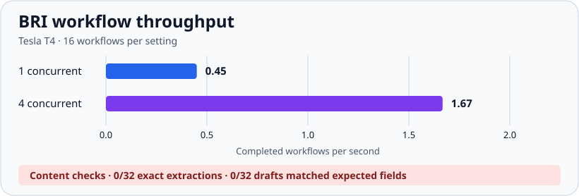

# 🟪 Extension 5 · BRI workflow benchmark

**✅ Benchmark verified on Tesla T4 · ❌ Neither content check passed on any of the 32 workflows**

The workflow asked Qwen2.5-0.5B-Instruct to extract four fields from a synthetic CI record and then draft a triage sentence. Each setting repeated four fixtures four times, for 16 workflows per setting. The run started on November 21, 2026 Pacific time (November 22 UTC). It used vLLM 0.12.0, FP16, eager execution, a 2,048-token context, and prefix caching disabled.

| Concurrent workflows | Returned without request error | Workflows/sec | Median total latency | p95 total latency | Exact extractions | Drafts matching expected fields |
|---:|---:|---:|---:|---:|---:|---:|
| 1 | 16/16 | 0.45 | 2019.6 ms | 3026.0 ms | 0/16 | 0/16 |
| 4 | 16/16 | 1.67 | 2395.3 ms | 3054.1 ms | 0/16 | 0/16 |

Four concurrent workflows raised completed throughput **3.70×** in this run. Latency includes both model calls and client-side parsing. With 16 workflows, the nearest-rank p95 is the slowest observation in each batch. Each setting ran once on a small synthetic workload.

## 🔎 Why the evidence checks failed

1. All 32 extractions returned JSON inside Markdown code fences. The parser expected bare JSON and returned an empty record in every case.
2. The JSON inside each fence also used an object for `evidence`, where the fixtures expect an exact string. For example, BIRCH-309 returned `{"log":"disk full"}` in that field. Removing the fences would still leave a type mismatch.
3. The runner continued to drafting with the empty record. All 32 drafts used the unsupported build ID `20231015-143736` and included both `PASS` and `FAIL`.

A validation gate could stop drafting when extracted fields fail schema or source-evidence checks. This experiment measured serving performance and exposed a task-quality failure for the tested model and prompts.

[Per-workflow evidence and run summaries](bri-workflow-run.json) · [Experiment protocol](EXTENSIONS.md)
