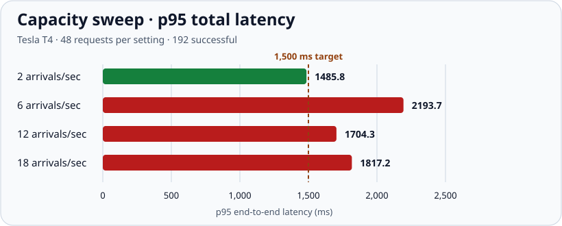

# 🚦 Extension 4 · Capacity and queue monitoring

**✅ Verified on Tesla T4 · 192/192 requests completed**

The runner sent 48 requests at each of four scheduled arrival rates on one Colab Tesla T4. It used vLLM 0.12.0, Qwen2.5-0.5B-Instruct, FP16, eager execution, a 2,048-token context, and prefix caching disabled. Setup and warm-up preceded the measured batches.

| Target arrivals/sec | Measured submissions/sec | Completed req/sec | p95 total (ms) | Peak sampled waiting | Peak sampled running | 1,500 ms target |
|---:|---:|---:|---:|---:|---:|---|
| 2 | 2.00 | 1.98 | 1485.8 | 0 | 3 | ✅ Met |
| 6 | 6.00 | 5.05 | 2193.7 | 0 | 9 | ❌ Missed |
| 12 | 12.00 | 9.25 | 1704.3 | 0 | 13 | ❌ Missed |
| 18 | 18.01 | 12.03 | 1817.2 | 0 | 21 | ❌ Missed |

**2 arrivals/sec was the highest tested rate that met the target.** The measured p95 was 1,485.8 ms there and exceeded 1,500 ms at every other tested rate. The sweep used one batch per setting. Its sampled rates leave a gap between 2 and 6 arrivals/sec, and p95 varied non-monotonically above the target.

Across all 157 successful metric scrapes, the waiting gauge was zero. Peak sampled running requests rose from 3 to 21. Scrapes were periodic, so transient waits between samples remain possible. The gauge observations do not establish what caused the latency changes.

Successful throughput includes the time for the batch to finish. Measured submission rate uses the interval from the first to last client submission. p95 uses nearest rank over successful requests.

[Per-request timings](capacity-requests.csv) · [Queue samples](capacity-queue.csv) · [Run metadata and summaries](capacity-runs.json) · [Experiment protocol](EXTENSIONS.md)
