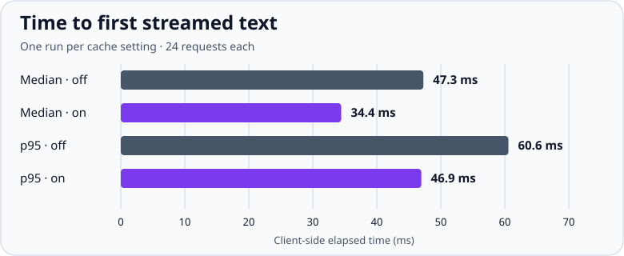

# 🟣 Extension 3 · Prefix caching comparison

**✅ Verified on Tesla T4 · 48/48 requests completed**

The experiment used one Colab Tesla T4 with vLLM 0.12.0 and Qwen2.5-0.5B-Instruct. It started separate servers with prefix caching disabled and enabled, in that order. Each server warmed up once, then served the same 24 requests sequentially with a shared 3,551-character release policy. Both startup logs confirmed the selected cache mode.

| Metric | Cache off | Cache on |
|---|---:|---:|
| Successful requests | 24/24 | 24/24 |
| Successful requests/sec | 1.29 | 1.28 |
| Median time to first text | 47.3 ms | 34.4 ms |
| p95 time to first text | 60.6 ms | 46.9 ms |
| Median total latency | 772.9 ms | 772.5 ms |
| p95 total latency | 958.9 ms | 1050.4 ms |
| Cached prompt tokens / queried prompt tokens | 0 / 0 | 17,280 / 17,799 (97.1%) |

Median time to first streamed text fell **27.2%** and p95 fell **22.5%** with caching enabled. Median total latency was essentially flat, and p95 total latency rose **9.5%**. Each setting ran once in a fixed order, so these are observations for this workload. The client measures the first text chunk and vLLM reports cache counters in tokens. The disabled setting's 0/0 means no prefix cache queries were recorded. [vLLM metric definitions](https://docs.vllm.ai/en/v0.12.0/api/vllm/v1/metrics/loggers/)

[Per-request timings](prefix-cache-requests.csv) · [Run summaries and cache deltas](prefix-cache-runs.json) · [Experiment protocol](EXTENSIONS.md)
