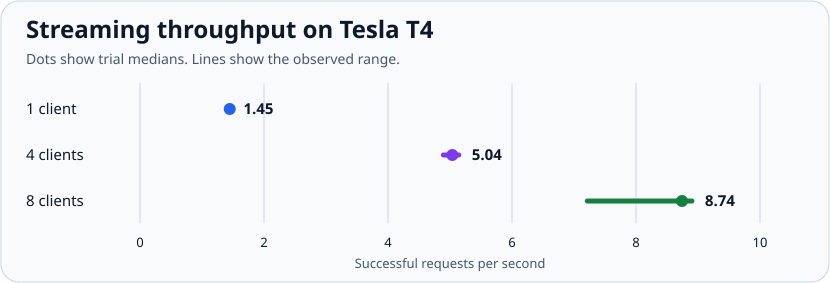

# 📊 Extension 2 · Repeatable streaming benchmark

**✅ Verified on Tesla T4 · 288/288 requests completed**

Nine measured trials ran on the same Colab Tesla T4, beginning November 21, 2026 Pacific time (November 22 UTC). Each trial sent 32 requests using four CI prompts. The runner rotated concurrency order across three trials per setting. It served Qwen2.5-0.5B-Instruct with vLLM 0.12.0, FP16, eager execution, a 2,048-token context, and prefix caching disabled.

Figures are medians across the three trial summaries. Parentheses show the observed minimum and maximum across trials. Each p95 is calculated within a trial using nearest rank.

| Clients | Requests/sec | p95 first streamed text (ms) | p95 total latency (ms) | Successful |
|---:|---:|---:|---:|---:|
| 1 | 1.45 (1.41–1.46) | 43.2 (41.3–46.7) | 1239.1 (1224.4–1300.7) | 96/96 |
| 4 | 5.04 (4.89–5.14) | 73.1 (66.1–92.4) | 1146.5 (1135.2–1153.7) | 96/96 |
| 8 | 8.74 (7.21–8.90) | 90.8 (82.0–93.6) | 1270.7 (1223.7–1746.8) | 96/96 |

Median throughput at eight clients was **6.04×** the single-client rate. Median trial p95 time to first streamed text rose from **43.2 ms to 90.8 ms**, and one eight-client trial reached **1,746.8 ms** p95 total latency. The run gives a view of variation on one runtime with short prompts. First streamed text is a client-side chunk measurement and may include more than one token.

The archived run's success counts, throughput, medians, and p95 values were recomputed from request records and trial wall times. [Per-request timings](streaming-requests.csv) · [Per-trial summaries](streaming-trials.csv) · [Experiment protocol](EXTENSIONS.md)
